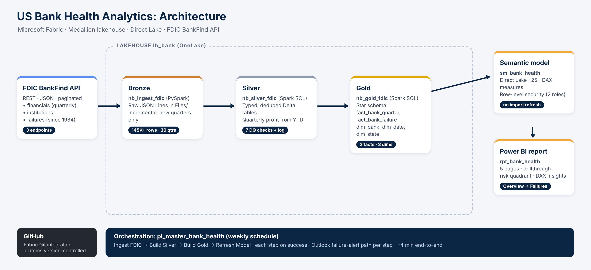
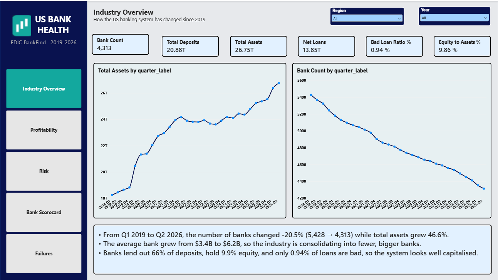
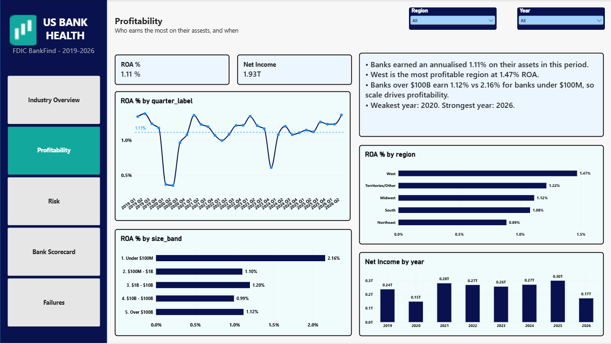
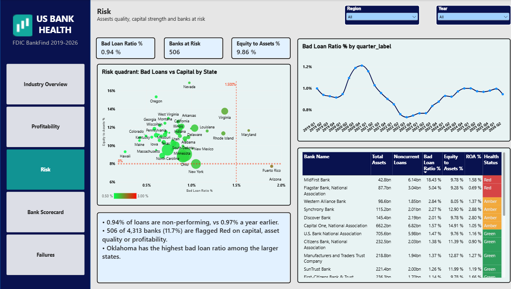
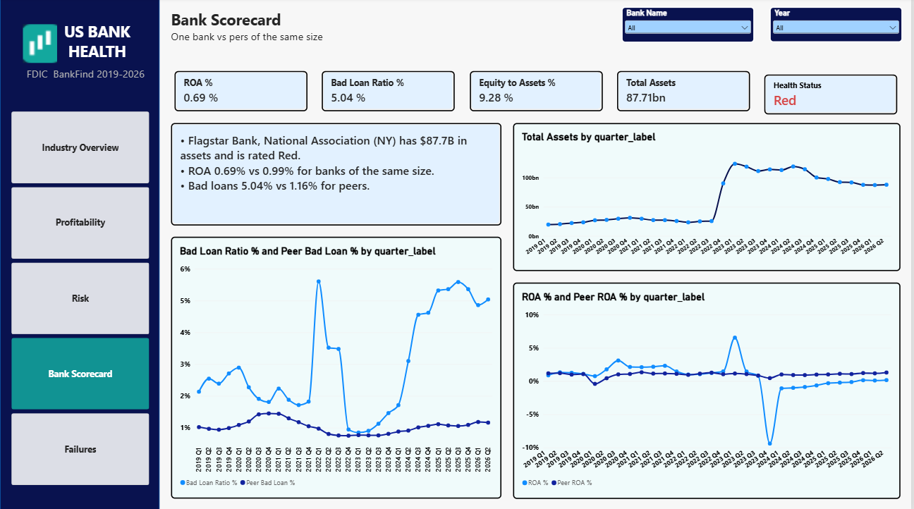
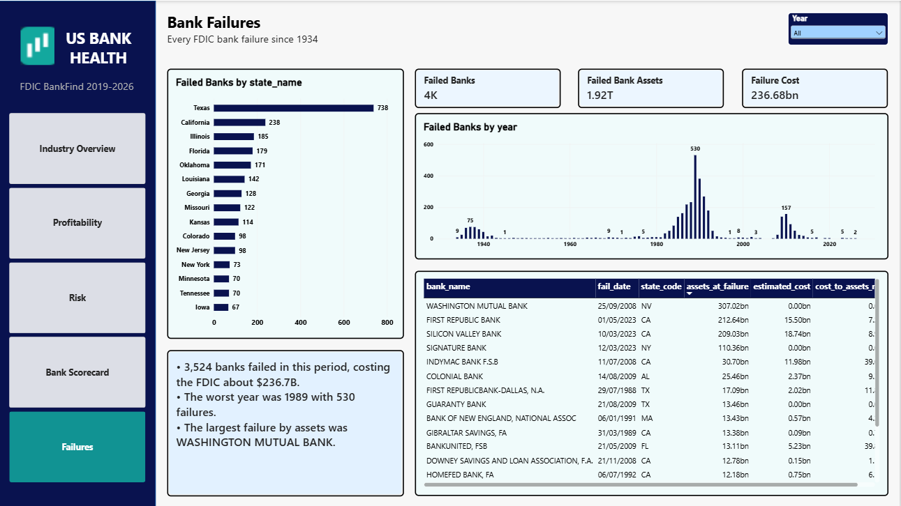

# US Bank Health Analytics: Microsoft Fabric End-to-End Project

An end-to-end analytics solution on **Microsoft Fabric** that tracks the health of every FDIC-insured bank in the United States: size, profitability, asset quality, capital strength, and failures. It runs from live API ingestion to an interactive Power BI report.

---

## Business questions

1. How is the US banking industry changing? (number of banks, total assets, consolidation)
2. Which regions and bank sizes are the most profitable?
3. Where is credit risk building up, and which banks look weak on capital, bad loans or profitability?
4. How does a single bank compare with peers of the same size?
5. What does the history of bank failures since 1934 tell us?

## Tech stack

| Layer | Tools |
|---|---|
| Source | FDIC BankFind REST API (financials, institutions, failures) |
| Ingestion | Fabric Notebook (PySpark), incremental and idempotent |
| Storage | Fabric Lakehouse `lh_bank` (OneLake, Delta Lake), medallion architecture |
| Transformation | Spark SQL (silver and gold) |
| Semantic model | Direct Lake, DAX, row-level security |
| Reporting | Power BI (5 pages) |
| Orchestration | Fabric Data Pipeline, weekly schedule |
| Version control | Git, GitHub, Fabric Git integration |

## Data at a glance

| Item | Volume |
|---|---|
| Bank-quarter financial records | **144,827** (30 quarters, 2019 Q1 to 2026 Q2) |
| Institutions | **27,835** |
| Bank failures (1934 to today) | **3,524** (after removing 593 assistance records) |
| Banks in latest quarter | **4,313** |

Row counts were reconciled **100%** against the API totals.

---

## Architecture

### 1. Bronze: `nb_ingest_fdic` (PySpark)
- Calls 3 FDIC endpoints with **limit/offset pagination** (10,000 rows per page).
- **Incremental:** loops over quarters and skips any quarter already stored. A normal refresh downloads only the newest quarter (about 4.3K rows) instead of the full history.
- Stores raw **JSON Lines** in `Files/bronze/fdic/<endpoint>/...`, partitioned by report date or load date.
- Parameterised (`start_year`), so the pipeline controls the history window.

### 2. Silver: `nb_silver_fdic` (Spark SQL)
- Casts types and parses dates. Converts amounts from $000s to dollars.
- Deduplicates with `ROW_NUMBER()`, keeping the latest load.
- Derives **quarterly net income** from year-to-date figures using `LAG()` window functions.
- Filters failures to `RESTYPE = 'FAILURE'`, which excludes open-bank assistance transactions such as the 2008-09 Citi and BofA support.
- **8 automated data-quality checks**, written to `silver.dq_log` on every run:

| Check | Rule |
|---|---|
| keys_not_null | cert and report_date are never null |
| pk_unique_cert_quarter | one row per bank per quarter |
| assets_not_negative | total assets ≥ 0 |
| equity_not_above_assets | equity ≤ assets |
| state_code_valid | 2-letter state code present |
| cert_exists_in_institutions | every financial row maps to a known bank |
| fail_date_parsed | every failure has a valid date |

The critical check raises an error, which stops the pipeline before bad data reaches gold.

### 3. Gold: `nb_gold_fdic` (Spark SQL), star schema
- **Facts:** `fact_bank_quarter` (balances, income, ratios) and `fact_bank_failure`
- **Dimensions:** `dim_bank` (size band, charter type, failed flag), `dim_date` (quarter grain, 1934 to today), `dim_state` (Census region)
- Referential-integrity checks: no orphan keys between facts and dimensions.

### 4. Semantic model: `sm_bank_health` (Direct Lake)
- Reads the gold Delta tables directly, with no import copy and no import refresh.
- **25+ DAX measures**, including:
  - **Semi-additive balances:** assets, deposits, loans and equity show the *latest quarter* in context, never a sum across quarters.
  - **Annualised ROA**, calculated per quarter with `AVERAGEX`, so acquired banks don't bias the result.
  - **Health score (Red / Amber / Green):** capital, asset quality and profitability thresholds, guarded against BLANK values.
  - **Peer benchmarking:** `REMOVEFILTERS` on the bank dimension, then re-filter to the same size band.
  - **Dynamic DAX commentary:** each page's insight text is generated by DAX and updates with every slicer.
- **Row-level security:** a regional analyst role (e.g., Northeast) sees 468 of 4,313 banks. It was tested with a fixed-identity cloud connection.

### 5. Report: `rpt_bank_health` (5 pages)

| Page | What it shows |
|---|---|
| Industry Overview | KPIs, asset growth vs shrinking bank count |
| Profitability | ROA over time, by region and by size band, net income by year |
| Risk | Risk-quadrant scatter (bad loans vs capital by state), riskiest banks with health colours |
| Bank Scorecard | One bank vs size-band peers. Drillthrough target from the Risk page |
| Failures | Failures by year and state, largest failures since 1934 |

#### Report screenshots

**Industry Overview**

**Profitability**

**Risk**

**Bank Scorecard**

**Failures**

### 6. Orchestration: `pl_master_bank_health`
`Ingest FDIC → Build Silver → Build Gold → Refresh Model`
- Each step runs only if the previous one succeeds. Each step also has an On-fail email alert path (switched off on the trial tenant, which has no mailbox).
- Runs on a weekly schedule. A full run takes about **4 minutes**.

---

## Key findings

- **Consolidation:** The number of US banks fell **20.5%** (5,428 → 4,313) between 2019 and 2026, while total assets grew **46.6%** to **$26.75T**. The average bank nearly doubled in size, from $3.4B to $6.2B.
- **Healthy system overall:** a bad loan ratio of **0.94%**, equity to assets of **9.86%** and an annualised ROA of **1.11%**.
- **Shocks are visible:** ROA dropped sharply in 2020 (COVID loan-loss provisions) and dipped again in late 2023.
- **Risk is concentrated:** **506 of 4,313 banks (11.7%)** are flagged Red. Among the larger states, Oklahoma has the highest bad loan ratio, driven largely by a single bank.
- **Failures:** **3,524** real failures since 1934, concentrated in the late-1980s Savings & Loan crisis and in 2009-2011. Washington Mutual (2008, $307B) is the largest.

## Data-quality issues found and fixed

1. **ROA bias:** The first ROA measure counted profits from banks that were later acquired but excluded their assets, which inflated small-bank ROA. It was fixed by calculating ROA quarter by quarter.
2. **Failures vs assistance:** The FDIC failures feed mixes real failures with open-bank assistance (Bank of America and Citibank appeared as "failed"). Profiling `RESTYPE` found 593 such records, which are now filtered in silver.
